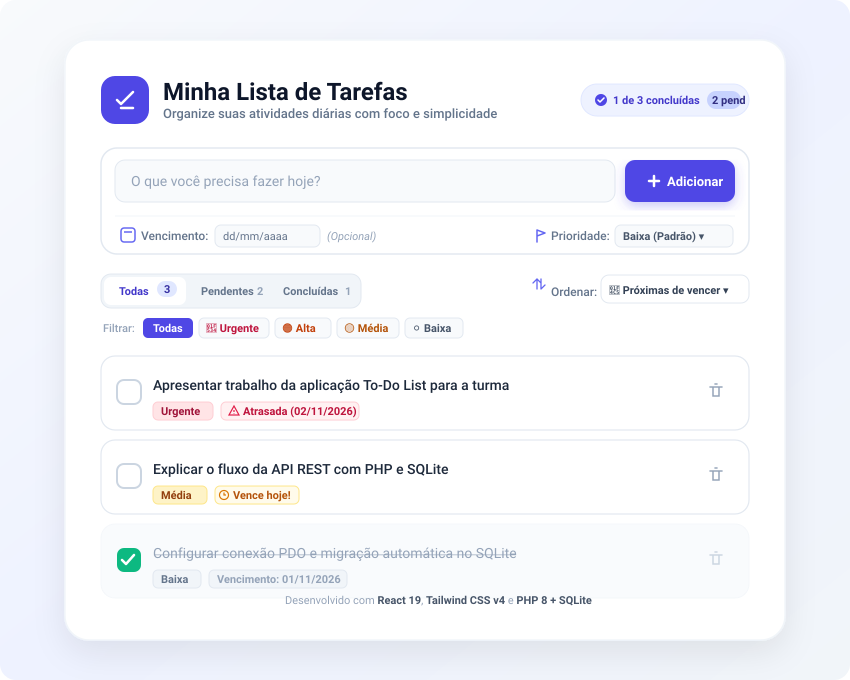

# 📝 Aplicação de Lista de Tarefas (To-Do List) Fullstack

> Projeto didático de Lista de Tarefas desenvolvido com **React 19**, **Tailwind CSS v4**, **PHP 8** e banco de dados **SQLite** em arquivo único local (zero dependências externas ou servidores de banco pesados).

---

## 📸 Prévia Visual da Aplicação

Abaixo está a renderização vetorial da interface desenvolvida:

<div align="center">
  
</div>

<br />

### 🎨 Esboço Estrutural dos Componentes (Mockup)

```
┌────────────────────────────────────────────────────────────────────────┐
│  [Ícone]  Minha Lista de Tarefas                (1 de 3 concluídas)   │
│           Organize suas atividades diárias...   [2 pendentes]          │
├────────────────────────────────────────────────────────────────────────┤
│  ┌────────────────────────────────────────────────────────┐ ┌────────┐ │
│  │ Digite o que você precisa fazer hoje...                │ │ + Add  │ │
│  └────────────────────────────────────────────────────────┘ └────────┘ │
│  📅 Vencimento: [dd/mm/aaaa] (Opcional)    🚩 Prioridade: [Baixa ▼]   │
├────────────────────────────────────────────────────────────────────────┤
│  [ Todas (3) ] [ Pendentes (2) ] [ Concluídas (1) ]    Ordenar: [📅 ▼] │
│  Filtrar: [Todas] [🔴 Urgente] [🟠 Alta] [🟡 Média] [⚪ Baixa]         │
├────────────────────────────────────────────────────────────────────────┤
│  [ ] Apresentar trabalho para a turma     [🔴 Urgente] [⚠️ Atrasada] [🗑]│
│  [ ] Explicar arquitetura PHP + SQLite    [🟡 Média]   [⏰ Vence hoje] [🗑]│
│  [✓] Configurar banco SQLite local        [⚪ Baixa]   [01/11/2026]  [🗑]│
└────────────────────────────────────────────────────────────────────────┘
```

---

## 🎯 Funcionalidades Principais

| Funcionalidade | Descrição |
| :--- | :--- |
| **➕ Adicionar Tarefas** | Campo de digitação rápido com validação contra entradas vazias. |
| **📅 Prazos de Vencimento** | Por padrão **sem data específica**; ao definir uma data, badges inteligentes indicam se a tarefa está **Atrasada**, **Vence hoje**, **Vence amanhã** ou no futuro. |
| **🚩 Níveis de Prioridade** | Por padrão prioridade **Baixa**, com opções para **Média**, **Alta** e **Urgente**. |
| **🔄 Ordenação Inteligente** | Alterna entre: <br>• **Próximas de vencer (Padrão):** prazos mais próximos primeiro, seguidas pelas sem data.<br>• **Por Prioridade:** Urgente ➔ Alta ➔ Média ➔ Baixa.<br>• **Mais recentes:** pela data de criação. |
| **🔍 Filtros Flexíveis** | Filtro duplo por status (**Todas / Pendentes / Concluídas**) e por prioridade específica (**Urgente, Alta, Média, Baixa**). |
| **✅ Concluir Atividade** | Checkbox reativo que aplica estilo tachado e atualiza instantaneamente o SQLite via HTTP `PATCH`. |
| **🗑️ Excluir Tarefas** | Remoção permanente via HTTP `DELETE`. |

---

## 🛠️ Tecnologias e Arquitetura

```
                       ┌─────────────────────────┐
                       │     NAVEGADOR WEB       │
                       │ React 19 + Tailwind CSS │
                       └────────────┬────────────┘
                                    │ Requisições HTTP
                                    │ (fetch JSON: GET, POST, PATCH, DELETE)
                                    ▼
                       ┌─────────────────────────┐
                       │     BACKEND PHP         │
                       │    (API REST nativa)    │
                       └────────────┬────────────┘
                                    │ Conexão PDO
                                    ▼
                       ┌─────────────────────────┐
                       │   BANCO DE DADOS LOCAL  │
                       │     tasks.db (SQLite)   │
                       └─────────────────────────┘
```

- **Frontend:** React 19 com Vite para compilação instantânea e recarga rápida (HMR).
- **Estilização:** Tailwind CSS v4, totalmente responsivo (mobile, tablet e desktop).
- **Backend:** PHP 8 nativo estruturado como API RESTful, com headers CORS habilitados.
- **Banco de Dados:** SQLite em arquivo local único (`backend/tasks.db`), gerenciado nativamente pelo PHP via PDO (sem necessidade de instalar MySQL, PostgreSQL ou Docker).

---

## 🚀 Como Executar

### Método 1: Inicializador Automático (1 Clique no Windows)
Basta dar um duplo clique no arquivo:
```text
iniciar.bat
```
Ele iniciará simultaneamente o servidor backend em PHP (`localhost:8000`) e o frontend React no Vite (`localhost:5173`), abrindo o endereço no seu navegador.

---

### Método 2: Via Terminal

**1. Iniciar o Backend (PHP):**
```bash
php -S localhost:8000 -t backend
```

**2. Iniciar o Frontend (React):**
```bash
cd frontend
npm run dev
```
Abra o navegador em `http://localhost:5173`.

---

# 🎓 Apresentação para a Turma: Diário de Bordo & Raciocínio da IA

Esta seção documenta o processo real de **Engenharia de Software Assistida por Agente Autônomo de IA**. Aqui você pode acompanhar como o agente inspecionou o ambiente operacional, planejou a arquitetura, validou hipóteses e desenvolveu o sistema passo a passo.

---

### 📍 Rodada 1: Diagnóstico de Ambiente e Tomada de Decisão

#### 🗣️ Solicitação Inicial do Usuário
> *"Quero criar uma aplicação simples de lista de tarefas, com uma interface visual que permita adicionar, concluir e remover atividades. Estou começando a aprender desenvolvimento de software... Preferencia em React, Tailwindcss, HTML e PHP... banco de dados em arquivo sem dependências externas."*

#### 🧠 Raciocínio e Diagnóstico do Agente:
1. **Em vez de adivinhar o ambiente**, o agente executou comandos de terminal para inspecionar as ferramentas já presentes no computador:
   - Verificou as versões do PHP e do Node.js:
     ```powershell
     php -v   # Resultado: PHP 8.4.12 instalado
     node -v  # Resultado: Node v24.21.0 instalado
     ```
   - Inspecionou os módulos do PHP para checar se o SQLite estava habilitado:
     ```powershell
     php -m   # Resultado: pdo_sqlite e sqlite3 ativos!
     ```
   *Conclusão:* A máquina do usuário possuía todas as ferramentas nativas para criar um projeto profissional sem precisar instalar nenhum programa adicional.

2. **Alinhamento Didático via Questionário Interativo:**
   O agente utilizou uma ferramenta de perguntas estruturadas (`ask_question`) para que o usuário decidisse:
   - A organização do React (Vite com componentes separados vs. CDN).
   - O estilo visual (Clean moderno índigo vs. Dark Mode).
   - O escopo de recursos extras (inclusão de filtros e contadores).
   *Decisão aprovada pelo usuário:* Estrutura Vite + React, tema clean moderno e filtros dinâmicos.

---

### 📍 Rodada 2: Construção da Fundação (MVP)

#### 🛠️ O que o Agente Executou:
1. **Criação do Frontend:**
   - Inicializou o projeto com Vite: `npm create vite@latest frontend -- --template react`.
   - Instalou Tailwind CSS e o pacote `lucide-react` para iconografia vetorial.
   - Configurou o arquivo `vite.config.js` com **proxy reverso**, permitindo que chamadas para `/api.php` fossem encaminhadas automaticamente para o servidor PHP na porta 8000, eliminando erros de CORS durante o desenvolvimento.

2. **Criação do Banco de Dados SQLite (`backend/database.php`):**
   - Escreveu a rotina de inicialização com PDO.
   - Configurou a criação automática da tabela `tasks` caso o arquivo `tasks.db` ainda não existisse.

3. **Criação da API RESTful (`backend/api.php`):**
   - Implementou os métodos HTTP fundamentais:
     - `GET`: Retorna todas as tarefas em JSON.
     - `POST`: Recebe o título, valida e insere no banco via *Prepared Statement* (proteção contra SQL Injection).
     - `PATCH`: Alterna o estado booleano de `completed`.
     - `DELETE`: Remove o registro pelo ID.

4. **Componentização Modular no React:**
   Dividiu a interface em componentes claros e bem documentados:
   - `TaskHeader.jsx`: Apresentação e progresso.
   - `TaskInput.jsx`: Formulário com validação.
   - `TaskFilter.jsx`: Abas de seleção.
   - `TaskItem.jsx`: Linha da tarefa com animações suaves de conclusão e exclusão.
   - `TaskList.jsx`: Lista com tratamento de tela vazia ilustrada.
   - `api.js`: Módulo de serviço isolado para chamadas `fetch`.

5. **Testes de Integração:**
   - Criou um script PHP para testar inserção, leitura, atualização e exclusão direta no SQLite.
   - Executou `npm run build` para garantir que o código React e Tailwind compilava com zero erros ou avisos de tipagem.

---

### 📍 Rodada 3: Expansão de Requisitos (Prazos e Prioridades)

#### 🗣️ Segunda Solicitação do Usuário
> *"Crie uma opção de inserir quando é a atividade, por padrão sem data e hora específica, caso ele selecione e insere o dia, faça listar primeiro o mais próximo de vencer. Crie a opção de inserir a prioridade, por padrão prioridade baixa. Depois a Média, alta e Urgente. Dentro das atividades dê a opção de listar por prioridade."*

#### 🧠 Raciocínio de Engenharia do Agente:

1. **O Desafio da Migração de Banco de Dados:**
   - O arquivo `tasks.db` já existia no disco com tarefas cadastradas na estrutura antiga.
   - *Risco:* Se a tabela fosse simplesmente recriada, os dados do usuário seriam perdidos. Se novas colunas fossem consultadas sem existirem, a aplicação travaria.
   - *Solução Técnica (Migração Automática):*
     O agente implementou em `backend/database.php` uma checagem com `PRAGMA table_info(tasks)`:
     ```php
     $existingColumns = array_column($pdo->query("PRAGMA table_info(tasks)")->fetchAll(), 'name');
     
     if (!in_array('due_date', $existingColumns)) {
         $pdo->exec("ALTER TABLE tasks ADD COLUMN due_date TEXT DEFAULT NULL");
     }
     if (!in_array('priority', $existingColumns)) {
         $pdo->exec("ALTER TABLE tasks ADD COLUMN priority TEXT NOT NULL DEFAULT 'baixa'");
     }
     ```
     Isso garantiu retrocompatibilidade total com zero intervenção manual.

2. **O Desafio da Ordenação SQL Ponderada:**
   - O usuário pediu para listar **primeiro as tarefas com prazo mais próximo**.
   - No SQL comum, campos com `NULL` costumam aparecer antes ou quebrar a ordem.
   - O agente formulou a seguinte lógica em SQL:
     ```sql
     ORDER BY 
         completed ASC,
         CASE WHEN due_date IS NULL OR due_date = '' THEN 1 ELSE 0 END ASC,
         due_date ASC,
         id DESC
     ```
     *Explicação:* 
     1. Tarefas pendentes ficam acima das concluídas.
     2. A expressão `CASE` atribui peso `0` para tarefas COM data e `1` para tarefas SEM data, garantindo que quem tem prazo apareça no topo.
     3. `due_date ASC` ordena cronologicamente (ex: 04/11 antes de 10/11).

3. **Ordenação Ponderada por Prioridade:**
   Como palavras em texto (`urgente`, `baixa`) não se ordenam por ordem alfabética de importância, o agente aplicou pesos numéricos em tempo de execução:
   ```sql
   CASE priority
       WHEN 'urgente' THEN 1
       WHEN 'alta'    THEN 2
       WHEN 'media'   THEN 3
       WHEN 'baixa'   THEN 4
       ELSE 5
   END ASC
   ```

4. **Experiência Visual Inteligente no Frontend:**
   - Criou lógica no `TaskItem.jsx` que calcula a diferença de dias entre a data de hoje e o vencimento:
     - Diferença negativa ➔ Exibe badge vermelha: `⚠️ Atrasada (DD/MM/AAAA)`
     - Diferença zero ➔ Exibe badge âmbar: `⏰ Vence hoje!`
     - Diferença 1 dia ➔ Exibe badge azul: `📅 Vence amanhã`
   - Adicionou seletor dinâmico de ordenação e botões de filtro por prioridade no `TaskFilter.jsx`.

5. **Validação Final:**
   - Executou baterias de testes via terminal PowerShell/PHP comprovando a ordenação das datas e pesos de prioridade.
   - Testou e concluiu a compilação de produção com o Vite em menos de 1 segundo.

---

### 💡 Por que este processo é interessante para demonstrar à turma?

1. **Não é apenas geração de texto:** O agente de IA operou como um desenvolvedor pleno pareando com você: diagnosticou o sistema operacional, criou arquivos reais, rodou o terminal, corrigiu detalhes sintáticos e validou tudo com testes automatizados.
2. **Boas Práticas de Engenharia:**
   - Separação estrita de responsabilidades (Frontend desacoplado do Backend).
   - Segurança nativa com Prepared Statements contra SQL Injection.
   - Migração limpa de banco de dados sem quebrar versões anteriores.
3. **Código Didático:** Todos os arquivos possuem comentários detalhados em português explicando o porquê de cada gancho do React (`useState`, `useEffect`) e de cada instrução SQL.
